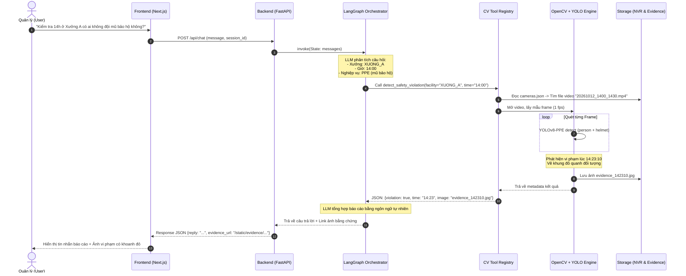
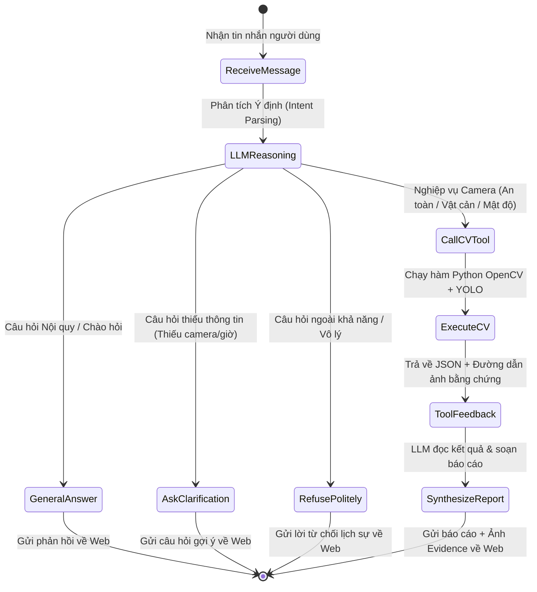

# TÀI LIỆU THIẾT KẾ KIẾN TRÚC HỆ THỐNG (SYSTEM ARCHITECTURE DESIGN)
## DỰ ÁN: MULTIMODAL AGENTIC CHATBOT GIÁM SÁT & QUẢN TRỊ VẬN HÀNH DOANH NGHIỆP
### (Smart Warehouse & Factory Operations Agent)

---

## 1. TỔNG QUAN KIẾN TRÚC ĐA TẦNG (MULTI-TIER ARCHITECTURE)

Hệ thống được thiết kế theo mô hình **Kiến trúc phân tầng hướng dịch vụ (Layered Service-Oriented Architecture)** kết hợp với cơ chế **Agentic Tool-Calling**:

```
┌────────────────────────────────────────────────────────────────────────┐
│                        TẦNG 1: PRESENTATION LAYER                      │
│                  (Giao diện Web Chat - Next.js / React)                │
│  - Chatbot Interface (Tin nhắn 2 chiều, bong bóng chat)                │
│  - Streaming UI: Hiển thị trạng thái Agent suy nghĩ theo thời gian thực│
│  - Evidence Viewer: Component hiển thị ảnh/video vi phạm có gắn bbox   │
│  - Multi-facility Navigation: Bộ lọc chọn Xưởng A, Kho B, Cổng xe      │
└───────────────────────────────────┬────────────────────────────────────┘
                                    │ HTTP REST / Server-Sent Events (SSE)
┌───────────────────────────────────▼────────────────────────────────────┐
│                    TẦNG 2: API GATEWAY & APPLICATION                   │
│                         (FastAPI Python Server)                        │
│  - Router: /api/chat (Nhận/stream phản hồi tin nhắn)                   │
│  - Static Asset Server: /static/evidence (Phục vụ ảnh/video vi phạm)   │
│  - Session & History Manager: Quản lý lịch sử hội thoại                │
│  - Camera Metadata Service: Đọc file cấu hình cameras.json             │
└───────────────────────────────────┬────────────────────────────────────┘
                                    │
┌───────────────────────────────────▼────────────────────────────────────┐
│                  TẦNG 3: AGENTIC ORCHESTRATION LAYER                   │
│                     (LangGraph + Google Gemini / GPT)                  │
│  - Planner / Intent Parser: Phân rã câu hỏi, trích xuất tham số        │
│  - StateGraph Manager: Quản lý vòng lặp suy luận (Reasoning Loop)      │
│  - Tool Registry: Đăng ký danh mục các công cụ thị giác (CV Tools)     │
│  - Fallback & Reflection: Xử lý ngoại lệ, hỏi lại, tổng hợp câu trả lời│
└───────────────────────────────────┬────────────────────────────────────┘
                                    │ Internal Python Function Calls
┌───────────────────────────────────▼────────────────────────────────────┐
│                   TẦNG 4: COMPUTER VISION (CV) ENGINE                  │
│               (Worker Services: PyTorch, YOLO, Supervision)            │
│  - Video I/O & Frame Sampler: Decord / OpenCV (Đọc video theo mốc giờ) │
│  - Object Detection: YOLOv8 (Person, Vehicle), YOLOv8-PPE (Mũ/Áo)      │
│  - Open-Vocabulary Detection: YOLO-World (Thùng hàng, pallet)          │
│  - Object Tracking: ByteTrack (Theo dõi thời gian tồn tại vật thể)     │
│  - Spatial Geometry: Supervision PolygonZone (Kiểm tra vùng đa giác)   │
│  - Evidence Annotator: Vẽ Bounding Box đỏ/xanh & xuất file ảnh         │
└───────────────────────────────────┬────────────────────────────────────┘
                                    │ File System I/O
┌───────────────────────────────────▼────────────────────────────────────┐
│                        TẦNG 5: DATA & STORAGE LAYER                    │
│  - NVR CCTV Storage: Cấu trúc thư mục video theo xưởng, camera và giờ  │
│  - Evidence Storage: Thư mục lưu trữ ảnh/clip trích xuất bằng chứng    │
│  - Metadata Config: cameras.json (Thông tin camera & tọa độ vùng ROI)  │
└────────────────────────────────────────────────────────────────────────┘
```

---

## 2. BIỂU ĐỒ LUỒNG DỮ LIỆU TUẦN TỰ (SEQUENCE DIAGRAM)

Biểu đồ dưới đây mô tả chính xác đường đi của một câu hỏi từ lúc người dùng gõ phím đến khi nhận được ảnh bằng chứng:



---

## 3. THIẾT KẾ MÁY TRẠNG THÁI LANGGRAPH (LANGGRAPH STATE GRAPH)

Quy trình ra quyết định của bộ não Agent được quản lý bởi một StateGraph tuần hoàn:



---

## 4. CHI TIẾT CÁC SCHEMA DỮ LIỆU CHUẨN (DATA CONTRACTS)

### 4.1. Cấu hình Camera & Mặt bằng Nhà xưởng (`config/cameras.json`)
```json
{
  "facilities": {
    "XUONG_A": {
      "name": "Nhà máy Sản xuất Xưởng A (Bình Dương)",
      "cameras": {
        "CAM_01_BOC_DO": {
          "title": "Khu vực Bốc dỡ hàng Cửa 1",
          "storage_dir": "data/cctv_storage/XUONG_A/CAM_01_BOC_DO",
          "rules": {
            "required_ppe": ["helmet", "vest"]
          }
        },
        "CAM_02_LOI_THOAT_HIEM": {
          "title": "Hành lang & Cửa thoát hiểm PCCC",
          "storage_dir": "data/cctv_storage/XUONG_A/CAM_02_LOI_THOAT_HIEM",
          "roi_zones": {
            "emergency_exit": [[120, 250], [480, 250], [480, 720], [120, 720]]
          },
          "rules": {
            "max_obstruction_minutes": 15
          }
        }
      }
    },
    "KHO_B": {
      "name": "Tổng kho Logistics Kho B (Hà Nội)",
      "cameras": {
        "CAM_03_DONG_GOI": {
          "title": "Khu vực Bàn đóng gói và Chia chọn",
          "storage_dir": "data/cctv_storage/KHO_B/CAM_03_DONG_GOI",
          "rules": {
            "max_crowd_threshold": 5
          }
        }
      }
    }
  }
}
```

### 4.2. Schema Output chuẩn của các CV Tools
Tất cả các CV Tool đều bắt buộc trả về định dạng chuẩn thống nhất để LangGraph đọc hiểu:

```json
{
  "tool_name": "detect_safety_violation",
  "status": "success",
  "has_violation": true,
  "summary": "Phát hiện 01 công nhân không đội mũ bảo hộ lúc 14:23:10",
  "details": {
    "facility": "XUONG_A",
    "camera_id": "CAM_01_BOC_DO",
    "timestamp": "14:23:10",
    "violation_type": "missing_helmet",
    "confidence": 0.89
  },
  "evidence": {
    "image_filename": "evidence_XUONG_A_CAM01_142310.jpg",
    "image_url": "/static/evidence/evidence_XUONG_A_CAM01_142310.jpg"
  }
}
```

---

## 5. THIẾT KẾ CẤU TRÚC THƯ MỤC DỰ ÁN (PROJECT REPO LAYOUT)

```text
thuc_tap/
├── backend/
│   ├── app/
│   │   ├── api/                         # [TẦNG GIAO TIẾP NGOẠI VI - TRANSPORT LAYER]
│   │   │   └── v1/                      # API Version 1 (Chuẩn doanh nghiệp bắt buộc có version)
│   │   │       ├── api_router.py        # Tập hợp tất cả các routers của v1
│   │   │       ├── endpoints/
│   │   │       │   ├── chat.py          # POST /api/v1/chat, GET /api/v1/chat/history
│   │   │       │   ├── cameras.py       # GET /api/v1/cameras, GET /api/v1/cameras/{id}
│   │   │       │   └── incidents.py     # GET /api/v1/incidents (Danh sách vi phạm)
│   │   │       └── dependencies.py      # Dependency Injection (DB Session, Auth, Services)
│   │   │
│   │   ├── core/                        # [TẦNG HẠ TẦNG CỐT LÕI - CORE INFRASTRUCTURE]
│   │   │   ├── config.py                # Pydantic Settings đọc .env (API Keys, DB URL, CORS)
│   │   │   ├── logging.py               # Enterprise Structured Logger (Ghi log console & file)
│   │   │   └── exceptions.py            # Custom Exceptions & Global Exception Handlers
│   │   │
│   │   ├── db/                          # [TẦNG LƯU TRỮ DỮ LIỆU - PERSISTENCE LAYER]
│   │   │   ├── session.py               # SQLAlchemy Engine & scoped SessionLocal
│   │   │   ├── base.py                  # Declarative Base cho các Models
│   │   │   ├── models/                  # Database Entities (ORM)
│   │   │   │   ├── conversation.py      # Bảng conversations & messages
│   │   │   │   └── incident.py          # Bảng incidents (Nhật ký vi phạm CCTV)
│   │   │   └── repositories/            # Repository Pattern (Tách rời truy vấn SQL khỏi Service)
│   │   │       ├── base_repo.py         # CRUD cơ bản (get, get_all, create, delete)
│   │   │       ├── chat_repo.py         # Truy vấn lịch sử hội thoại
│   │   │       └── incident_repo.py     # Truy vấn lọc theo ngày, xưởng, loại vi phạm
│   │   │
│   │   ├── schemas/                     # [TẦNG HỢP ĐỒNG DỮ LIỆU - DATA TRANSFER OBJECTS (DTO)]
│   │   │   ├── common.py                # APIResponse chuẩn: { success: bool, data: T, message: str }
│   │   │   ├── chat.py                  # ChatRequest, ChatResponse, MessageDTO
│   │   │   ├── camera.py                # CameraDTO, FacilityDTO, ROIZoneDTO
│   │   │   └── incident.py              # IncidentDTO, IncidentFilterParams
│   │   │
│   │   ├── services/                    # [TẦNG NGHIỆP VỤ DOANH NGHIỆP - BUSINESS LOGIC LAYER]
│   │   │   ├── chat_service.py          # Điều phối luồng chat: lưu DB -> gọi Agent -> cập nhật DB
│   │   │   ├── camera_service.py        # Đọc & quản lý metadata camera từ file cấu hình
│   │   │   └── incident_service.py      # Thống kê, xuất báo cáo sự cố vi phạm
│   │   │
│   │   ├── agent/                       # [PHÂN HỆ AGENTIC AI - ORCHESTRATION SUBSYSTEM]
│   │   │   ├── state.py                 # TypedDict State cho LangGraph
│   │   │   ├── prompts/                 # Quản lý Prompt templates tập trung
│   │   │   │   └── system_prompt.py
│   │   │   ├── graph.py                 # LangGraph StateGraph (Router, ToolsNode, Fallback)
│   │   │   └── tools/                   # LangChain Tool Adapters (Bọc các hàm CV thành Tool)
│   │   │       ├── safety_tool.py
│   │   │       ├── obstruction_tool.py
│   │   │       └── crowd_tool.py
│   │   │
│   │   └── cv_engine/                   # [PHÂN HỆ THỊ GIÁC MÁY TÍNH - COMPUTER VISION WORKERS]
│   │       ├── core/
│   │       │   ├── video_reader.py      # Frame Sampler (Decord / OpenCV bước nhảy thời gian)
│   │       │   └── visualizer.py        # Vẽ Bounding Box, Polygon Zone, nhãn vi phạm & xuất file
│   │       ├── models/                  # Quản lý nạp model AI vào VRAM/RAM (Singleton Pattern)
│   │       │   └── model_registry.py
│   │       └── detectors/               # Các thuật toán xử lý nghiệp vụ cụ thể
│   │           ├── ppe_detector.py      # YOLOv8 PPE (mũ, áo phản quang)
│   │           ├── obstruction_tracker.py # YOLO-World + ByteTrack (thùng hàng chiếm lối)
│   │           └── crowd_analyzer.py    # YOLOv8 + Supervision PolygonZone (mật độ)
│   │
│   ├── config/                          # [CẤU HÌNH DOANH NGHIỆP NGOÀI MÃ NGUỒN]
│   │   └── cameras.json                 # Bản đồ camera các xưởng (XUONG_A, KHO_B)
│   │
│   ├── storage/                         # [LƯU TRỮ TỆP TIN DỮ LIỆU]
│   │   ├── cctv_videos/                 # Cấu trúc lưu trữ video chuẩn NVR (theo xưởng & mốc giờ)
│   │   │   ├── XUONG_A/
│   │   │   └── KHO_B/
│   │   ├── evidence/                    # Ảnh/video vi phạm xuất ra cho Web xem
│   │   └── database/
│   │       └── warehouse.db             # File SQLite CSDL
│   │
│   ├── .env.example                     # File mẫu biến môi trường (API Key, Port, CORS)
│   ├── requirements.txt                 # Dependencies quản lý chặt chẽ theo phiên bản
│   └── main.py                          # Entrypoint khởi tạo FastAPI Application & Middleware
│
├── frontend/                        # Next.js 14 / React Web Chat
│   ├── src/
│   │   ├── app/
│   │   │   ├── layout.tsx
│   │   │   └── page.tsx             # Giao diện Chat chính
│   │   ├── components/
│   │   │   ├── ChatBox.tsx          # Khung tin nhắn
│   │   │   ├── MessageItem.tsx      # Bong bóng chat
│   │   │   ├── EvidenceCard.tsx     # Card ảnh bằng chứng phóng to
│   │   │   └── StatusIndicator.tsx  # Trạng thái "Đang chạy YOLO..."
│   │   └── services/
│   │       └── api.ts               # Gọi API sang backend
│   ├── package.json
│   └── tailwind.config.js
│
└── docs/
    ├── PROJECT_SPEC.md              # Đặc tả nghiệp vụ
    ├── PROJECT_MASTER_SPEC.md       # Ý tưởng & Tính khả thi toàn diện
    ├── DEVELOPMENT_GUIDE.md         # Hướng dẫn code từng bước
    └── SYSTEM_ARCHITECTURE.md       # Tài liệu kiến trúc này
```

---

## 6. CÁC ĐẶC ĐIỂM KỸ THUẬT NỔI BẬT ĐẠT CHUẨN DOANH NGHIỆP

1. **Hiệu năng cao với Frame Sampling**: Không giải mã 30 fps gây nghẽn phần cứng. Sử dụng thuật toán bước nhảy thời gian (Time-step stride) chỉ lấy mẫu 1 frame/giây, giúp xử lý đoạn clip 15 phút chỉ trong 3–5 giây.
2. **Cơ chế Streaming Trạng thái (Live Status Indicator)**: Người dùng trên web không phải chờ màn hình trắng mà thấy rõ từng bước của AI: *Đang định tuyến camera $\rightarrow$ Đang quét mô hình YOLO $\rightarrow$ Đang xuất ảnh vi phạm*.
3. **Mở rộng không giới hạn (Plugin Architecture)**: Khi cần thêm tính năng mới (ví dụ: phát hiện khói lửa `detect_fire`), chỉ cần thêm 1 file vào `cv_engine/` và khai báo vào `Tool Registry` của LangGraph. Giao diện Web và API hoàn toàn giữ nguyên!
